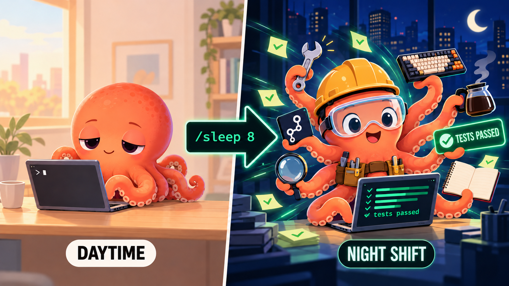

<h1 align="center">i-want-to-sleep</h1>

<p align="center">
  <b>Say "I'm going to sleep". Wake up to finished work, a tested branch, and a report.</b><br>
  A Claude Code plugin that takes over your session for N hours.
</p>

<p align="center">
  <a href="LICENSE"></a>
  
  
  
  <a href="README.zh-TW.md"></a>
</p>

<p align="center"></p>

## Quick start

```bash
claude plugin marketplace add jaylooloomi/i-want-to-sleep
claude plugin install i-want-to-sleep@jaylooloomi
export CLAUDE_CODE_STOP_HOOK_BLOCK_CAP=0
claude --dangerously-skip-permissions
```

Then, in a session that already has work in progress:

```
/i-want-to-sleep:sleep 8
```

Come back in 8 hours. The last message in the session is a wrap-up report; the branch `night-shift/<date>` is pushed and ready for a merge request.

> **Scope.** `claude plugin install` defaults to **user scope**: the plugin is active in every project on this machine, and the evidence-check Stop hook costs one small-model call per turn end in every session. To limit it to one repository, add `--scope local` (just you) or `--scope project` (everyone on the repo). Same flag applies to every install command below.

## Why

You stop working at midnight with a half-finished feature. The model could keep going — it has the context, it can run the tests — but every turn ends with "anything else?" and nobody is there to say yes.

This plugin removes that stop. It turns the open session into a bounded, guarded autonomous run:

| Without | With |
|---|---|
| Work stops when you do | Work continues for the hours you specify |
| Context is lost overnight | The conversation is compressed into `scope.md` and used as the contract |
| "Autonomous" agents wander off-scope | Bonus work must trace back to your original requirement, scored, with a minimum bar |
| Agents push to main / install deps / touch CI | Hard-blocked by PreToolUse hooks, not by prompt text |
| You review a 2,000-line diff | One commit per item; merge the good ones, `git revert` the rest |

## How it works

```
/sleep 8
   │
   ▼
Step 0  record BASE = current branch; branch night-shift/<date> from it; ACTIVE flag; DEADLINE = now + 8h
Step 1  read the whole conversation → scope.md (requirement / done / unfinished / rejected)
Step 2  finish every unfinished item — one commit each, build + unit tests, 3 retries
Step 3  research competitors & top projects for ideas that serve the original requirement
Step 4  score (Impact × Urgency) / (Effort × Blast); skip anything < 2
Step 5  implement the winner with tests — one isolated commit (bonus-01, bonus-02, …)
   ▲                         │
   └── back to Step 4 ◄──────┘   until the deadline
Step 6  push branch, write result.md, post the wrap-up report in chat
```

Three mechanisms make this run unattended — and keep the model from grading its own homework:

- **Stop hook** — every time Claude tries to end its turn while `.agent-pipeline/ACTIVE` exists, the hook sends it back with the next instruction. At the deadline it asks for wrap-up once, then lets go.
- **PreToolUse hooks** — deterministic shell scripts (no model involved) that block `git push` to anything but `night-shift/*`, `merge` / `rebase` / `reset --hard` / `--force`, `rm -rf`, package installs, and edits to CI config, migrations, settings files and dependency manifests.
- **A small-model review layer** — three places where a separate, cheap model (Haiku) checks the main model instead of letting it self-certify, the same idea behind Claude Code's `/goal` evaluator:

  | Where | Who | What it does |
  |---|---|---|
  | after `scope.md` is written | `scope-reviewer` subagent | re-reads the conversation and reports where the contract misreads the user; uncertain items become `[存疑]` and are skipped |
  | before each bonus item | `scorer` subagent | scores the candidates; the main model must adopt the result and may only move *down* the list |
  | every turn end | prompt-type Stop hook | checks that the turn used tools, printed `git status`, and has command output behind any "tests passed" claim; sends the turn back naming the one missing piece of evidence |

The deterministic hooks are inert when `ACTIVE` is absent. The evidence-check hook short-circuits to "ok" when no night shift is active, but it does cost one small-model call per turn end in every session.

## Usage

Before the first run, check which branch you are on. The night-shift branch forks from **your current HEAD**, the morning report diffs against that branch, and the merge request should target it — not `main`. If you have an unrelated long-running branch checked out, switch or clean up first.

```
/i-want-to-sleep:sleep               # 8 hours (default)
/i-want-to-sleep:sleep 2             # 2 hours — works in the daytime too
/i-want-to-sleep:sleep 8 use the SQLite version as the baseline
/i-want-to-sleep:sleep 1 wrap-up only
```

The first number is the duration in hours. Anything after it is passed to the skill as instructions. Saying "I'm going to sleep" or "take over for 3 hours" in plain language also triggers it.

### In the morning

1. Read the wrap-up report in the session (what was done, sources, test status, files, decisions needed). Details in `.agent-pipeline/result.md`.
2. Open a merge request from `night-shift/<date>` **into the branch you started from** (recorded in `.agent-pipeline/BASE`). Each bonus item is an independent commit.
3. Wrong direction? Say so in the same session.
4. Delete `.agent-pipeline/` after merging.

## Install

<details>
<summary><b>Ask your agent</b></summary>

Paste into Claude Code:

> Install https://github.com/jaylooloomi/i-want-to-sleep

**If you are the AI agent reading this**, run exactly this — `--scope local` unless the user said otherwise:

```bash
claude plugin marketplace add jaylooloomi/i-want-to-sleep
claude plugin install i-want-to-sleep@jaylooloomi --scope local
claude plugin list
```

Then stop. Do **not** try to `export CLAUDE_CODE_STOP_HOOK_BLOCK_CAP=0` or relaunch with `--dangerously-skip-permissions`: an `export` inside your Bash tool dies with that subshell and never reaches the user's terminal, and the permission flag is a launch argument you cannot apply to a running session. Point the user to [Human-only steps](#human-only-steps) and let them do those two things themselves.
</details>

<details>
<summary><b>One-liner</b></summary>

```bash
curl -fsSL https://raw.githubusercontent.com/jaylooloomi/i-want-to-sleep/main/install.sh | bash
```
</details>

<details>
<summary><b>Inside a Claude Code session</b></summary>

```
/plugin marketplace add jaylooloomi/i-want-to-sleep
/plugin install i-want-to-sleep@jaylooloomi
```
</details>

<details>
<summary><b>Try without installing</b></summary>

```bash
git clone https://github.com/jaylooloomi/i-want-to-sleep.git
claude plugin validate ./i-want-to-sleep
claude --plugin-dir ./i-want-to-sleep/plugins/i-want-to-sleep
```
</details>

<details>
<summary><b>Update / uninstall</b></summary>

```bash
claude plugin marketplace update jaylooloomi
claude plugin update i-want-to-sleep@jaylooloomi

claude plugin uninstall i-want-to-sleep@jaylooloomi
claude plugin marketplace remove jaylooloomi
```
</details>

## Human-only steps

The plugin cannot set these, and neither can an agent inside a session: environment variables must live in *your* shell, and the permission mode is a launch flag. Do them yourself, once.

| Setting | Value | Required | Why |
|---|---|---|---|
| Permission mode | `claude --dangerously-skip-permissions` (or auto mode) | **yes** | nobody is awake to approve tool calls |
| `CLAUDE_CODE_STOP_HOOK_BLOCK_CAP` | `0` | **yes** | Claude Code ends a turn after 8 consecutive stop-hook continuations by default; `0` removes the cap. The plugin enforces its own deadline and turn limit |
| `NIGHT_SHIFT_HOURS` | hours, default `8` | no | used only when `/sleep` gets no number |
| `NIGHT_SHIFT_MAX_TURNS` | integer, default `120` | no | turn-count safety net |
| Git credentials | push access to `night-shift/*`; protect `main` server-side | — | the hook only allows pushes to the night-shift branch; `main` protection is the server's job |
| Machine | keep awake; on a subscription plan, enable "continue when usage limit resets" | — | hitting the usage limit pauses the session |

Put the two exports in `~/.zshrc` / `~/.bashrc`. `CLAUDE_CODE_STOP_HOOK_BLOCK_CAP=0` is safe globally: this plugin's Stop hook only blocks while `ACTIVE` exists.

## Compatibility

| Harness | Status |
|---|---|
| Claude Code (CLI, desktop app, Remote Control) ≥ 2.1.139 | ✅ supported |
| claude.ai web / mobile chat | ❌ cannot run a session unattended |
| OpenAI Codex CLI, Cursor, Gemini CLI, Copilot CLI, … | ❌ not yet — the skill, the `/sleep` command and both hooks are packaged as a Claude Code plugin |

This plugin does not use `/goal`; it is built on Claude Code's Stop and PreToolUse hooks. Codex, Cursor, Gemini CLI and Copilot CLI all have stop-hook equivalents (see [goal-loop](https://github.com/bodecloud/goal-loop) for a cross-harness example), so a port is feasible: the procedure (`SKILL.md`) moves as-is, the two shell guards need each harness's hook format. PRs welcome.

## What's in the box

| Path | Role |
|---|---|
| `plugins/i-want-to-sleep/skills/night-shift-job-generator/SKILL.md` | the procedure: scope → wrap-up → research → score → implement → report |
| `plugins/i-want-to-sleep/commands/sleep.md` | `/i-want-to-sleep:sleep [hours] [instructions]` |
| `plugins/i-want-to-sleep/hooks/hooks.json` | registers the four hooks (3 command, 1 prompt) |
| `plugins/i-want-to-sleep/scripts/night-shift-stop.sh` | Stop hook: keep working; request wrap-up at the deadline |
| `plugins/i-want-to-sleep/scripts/guard-bash.sh` | PreToolUse guard for shell commands |
| `plugins/i-want-to-sleep/scripts/guard-write.sh` | PreToolUse guard for file writes |
| `plugins/i-want-to-sleep/agents/scope-reviewer.md` | Haiku subagent: second reading of `scope.md` |
| `plugins/i-want-to-sleep/agents/scorer.md` | Haiku subagent: independent candidate scoring |
| `.claude-plugin/marketplace.json` | makes this repo installable as a marketplace |
| `install.sh` | one-line installer |

## FAQ

**Will it push to `main`?**
No. The Bash guard allows `git push` only to `night-shift/*`, never with `--force` or `--delete`. Protect `main` on the server anyway — the guard is a blocklist and blocklists can be circumvented.

**Will it install dependencies?**
No. `dotnet add package`, `npm install <pkg>`, `pip install` and similar are blocked. Ideas that need a new dependency go to `result.md` under "decisions needed".

**What stops it from drifting off-topic?**
Every bonus candidate must be written as "because the requirement is X, top implementations also do Y" and must cite a source. A separate Haiku subagent scores them — the main model cannot grade its own ideas — and anything below 2 is skipped.

**What if the build is broken at the deadline?**
It commits the state as `[WIP-FAILED]`, explains the blocker in `result.md`, and still writes the report. Nothing is force-pushed or reverted.

**Does it remember previous nights?**
No, by design. Each run reads only the current conversation and the current repo. `.agent-pipeline/` is wiped at Step 0.

**Does it work in the daytime?**
Yes. `/sleep 2` is a two-hour handover. The name is a joke; the deadline is not.

## Limitations

- Guards are pattern-based blocklists tuned to avoid blocking normal commands; a determined model can find a way around them. Branch isolation plus a protected `main` is the real safety net.
- The wrap-up report format is a skill instruction; if the context is compacted mid-run, the report may deviate. `result.md` is the source of truth.
- Not yet battle-tested at scale. Watch the first few turns of your first run.

## Contributing

Issues and PRs welcome. Run `claude plugin validate .` before opening a PR. If you port the procedure to another harness, open an issue — a link from Compatibility is yours.

## License

[MIT](LICENSE)
