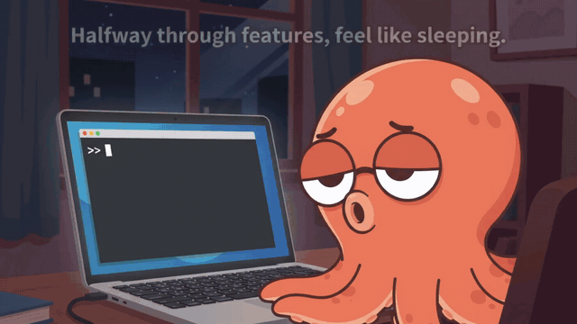

<h1 align="center">i-want-to-sleep 😴</h1>

<p align="center">
  <b>Silicon Valley's most unhinged workflow. Now yours.</b><br>
  Type <code>/sleep 8</code>. Go to bed. Wake up to shipped features, green tests, and a branch waiting for your merge.
</p>

<p align="center">
  <a href="LICENSE"></a>
  
  
  
  
  
  <a href="tests"></a>
  <a href="README.zh-TW.md"></a>
</p>

<p align="center"></p>

## Use cases

| Situation | Command | Why it fits |
|---|---|---|
| 🌙 **Overnight handover** | `/sleep 8` | You stop mid-feature with all the context loaded — it finishes the job |
| 💳 **Subscription quota about to reset** | new session in any repo: `/sleep 3` | Unused quota vanishes at the reset. No chat needed: with an empty conversation it pulls work from the repo's TODOs, failing tests and roadmap (repo mode) |
| 🍱 **Lunch, meetings, commute** | `/sleep 1 wrap-up only` | Short and scoped — your half-done work is tidied by the time you're back |
| ✈️ **Travel, flights, weekends** | `/sleep 12` | Long absence, one batch to review when you return |
| 🎯 **Night before a client demo** | `/sleep 8 use the demo flow as the baseline` | Anchors the scope on the demo, so every bonus lands where the client will look |
| 🧪 **Hardening and hidden bugs** | `/sleep 6 focus on tests and stability` | Night one in the field: tests 652 → 744, three false passes in the harness caught |
| ⚡ **Performance work** | `/sleep 6 focus on performance` | Night two in the field: date switch 7–23 s → 0.65 s |
| 🔍 **Competitive gap analysis** | `/sleep 8 bonus only` | Research is built in — you wake up to a feature-gap list that already has commits |

On Codex use `$sleep` instead: `$sleep 3 focus on performance`.

## Install

Pick your agent and follow its three steps.

**Requires:** Claude Code ≥ 2.1.139 or Codex CLI ≥ 0.122 · git · bash · Python 3.8+ · macOS, Linux, or Windows via WSL / Git Bash

### Claude Code

**1. Copy this and paste it into Claude Code**
```
1. claude plugin marketplace add jaylooloomi/i-want-to-sleep
2. claude plugin install i-want-to-sleep@jaylooloomi --scope user
3. claude plugin list — confirm i-want-to-sleep@jaylooloomi is enabled
4. In ~/.claude/settings.json, add "CLAUDE_CODE_STOP_HOOK_BLOCK_CAP": "0" to "env" (keep existing content)
5. Report done
```

**2. Start a new session that skips approval prompts**

- Desktop app (Code tab): bottom-left Settings → Claude Code → turn on "Allow bypass permissions mode" (once) → start a new session and pick **Bypass permissions** in the mode selector (Auto mode also works)
- Terminal:
  ```bash
  claude --dangerously-skip-permissions
  ```

**3. In a session that already has work in progress, type**
```
/i-want-to-sleep:sleep 8
```

Come back in 8 hours and read the report.

### OpenAI Codex

**1. Copy this and paste it into Codex**
```
1. codex plugin marketplace add jaylooloomi/i-want-to-sleep
2. codex plugin add i-want-to-sleep@jaylooloomi
3. Report done
```

**2. Start a new session and trust the hooks**
```bash
codex --yolo
```
Then run `/hooks` and trust the i-want-to-sleep hooks (once). **Skip this and nothing runs**: Codex does not execute plugin hooks until you trust them.

**3. In a session that already has work in progress, type**
```
$sleep 8
```
Or just say it: "I'm going to sleep, take over for 8 hours".

Come back in 8 hours and read the report.

<details>
<summary><b>What differs on Codex</b></summary>

The small-model evidence-check hook is skipped (Codex ignores prompt-type hooks), and the scope-reviewer / scorer / reporter subagents fall back to Codex's own agents or a separate pass. Guards and the Stop-hook loop work the same. `--yolo` also disables Codex's sandbox; `--full-auto` keeps the sandbox but may pause for approval when it needs the network (e.g. to push). Requires Codex CLI ≥ 0.122.
</details>

### More options

<details>
<summary><b>Only want it in one repository?</b></summary>

In the Claude Code step 1, replace `--scope user` with `--scope local`. User scope enables the plugin in every project on this machine, and the evidence-check hook costs one small-model call per turn end in every session; local scope limits it to the current repo.
</details>

<details>
<summary><b>Do it yourself without an agent</b></summary>

```bash
claude plugin marketplace add jaylooloomi/i-want-to-sleep
claude plugin install i-want-to-sleep@jaylooloomi          # add --scope local for one repo
```

Or one line:

```bash
curl -fsSL https://raw.githubusercontent.com/jaylooloomi/i-want-to-sleep/main/install.sh | bash
```

Then set the env var (one of two ways) and launch:

```bash
# A. In Claude Code settings (once)
#   ~/.claude/settings.json → "env": { "CLAUDE_CODE_STOP_HOOK_BLOCK_CAP": "0" }
# B. Per launch
export CLAUDE_CODE_STOP_HOOK_BLOCK_CAP=0

claude --dangerously-skip-permissions
```
</details>

<details>
<summary><b>What these settings do</b></summary>

| Setting | Why |
|---|---|
| `--dangerously-skip-permissions` | nobody is awake to approve tool calls. To avoid typing it nightly, put `"permissions": { "defaultMode": "bypassPermissions" }` in the repo's `.claude/settings.local.json`; auto mode also works |
| `CLAUDE_CODE_STOP_HOOK_BLOCK_CAP=0` (`env` in `~/.claude/settings.json`) | Claude Code ends a turn after 8 consecutive stop-hook continuations by default; `0` removes the cap. The plugin enforces its own deadline and turn limit |
| `NIGHT_SHIFT_HOURS` (optional, default 8) | duration when `/sleep` gets no number |
| `NIGHT_SHIFT_MAX_TURNS` (optional, default 120) | turn-count safety net |

The permission mode is fixed once a session starts, so opening a new session after Step 1 is the one thing an agent cannot do for you.

Also: push credentials only need access to `night-shift/*` — protect `main` server-side; keep the machine awake; on a subscription plan enable "continue when usage limit resets".
</details>

<details>
<summary><b>Try / update / uninstall</b></summary>

```bash
# try without installing
git clone https://github.com/jaylooloomi/i-want-to-sleep.git
claude plugin validate ./i-want-to-sleep
claude --plugin-dir ./i-want-to-sleep/plugins/i-want-to-sleep

# update
claude plugin marketplace update jaylooloomi
claude plugin update i-want-to-sleep@jaylooloomi

# uninstall
claude plugin uninstall i-want-to-sleep@jaylooloomi
claude plugin marketplace remove jaylooloomi
```

Requires Claude Code v2.1.139 or later.
</details>

## Usage

Before the first run, check which branch you are on. The night-shift branch forks from **your current HEAD**, the morning report diffs against that branch, and the merge request should target it — not `main`. If you have an unrelated long-running branch checked out, switch or clean up first.

```
/i-want-to-sleep:sleep               # 8 hours (default)
/i-want-to-sleep:sleep 2             # 2 hours — works in the daytime too
/i-want-to-sleep:sleep 8 use the SQLite version as the baseline
/i-want-to-sleep:sleep 1 wrap-up only
/i-want-to-sleep:sleep 6 focus on performance
/i-want-to-sleep:sleep 8 bonus only
/i-want-to-sleep:wake                # stop early: finish the current item, then wrap up and report
/i-want-to-sleep:wake now            # stop now: commit work in progress as [WIP-STOPPED], then report
```

Not at the keyboard? From another terminal or over SSH, `touch .agent-pipeline/STOP` — it wraps up at the end of the current turn. On Codex: `$sleep 8`, `$wake`, `$wake now` — or just say "stop, wrap up".

The first number is the duration in hours. Anything after it is passed to the skill as instructions. Saying "I'm going to sleep" or "take over for 3 hours" in plain language also triggers it.

### In the morning

<p align="center"></p>


1. Read the wrap-up report in the session (what was done, sources, test status, files, decisions needed). Details in `.agent-pipeline/result.md`.
2. Open a merge request from `night-shift/<date>` **into the branch you started from** (recorded in `.agent-pipeline/BASE`). Each bonus item is an independent commit.
3. Wrong direction? Say so in the same session.
4. Delete `.agent-pipeline/` after merging.

## Field-tested

Two real projects, one night each. Numbers unedited.

| | 🎮 Godot party game | 📈 Taiwan stock heatmap |
|---|---|---|
| **Shipped** | 7 features | 25 features |
| **Fixed** | 7 defects, incl. 3 false passes in the test harness | 5 independent review rounds, all findings fixed |
| **Tests** | 652 → 744, new fuzz gate | pytest 128 ✅ node 27 ✅ |
| **Perf** | — | date switch 7–23 s → 0.65 s |
| **Converged** | 2.5 h early, no candidate above the bar | 5.5 h early, two rounds with no qualifying candidate |
| **Restraint** | 65 % 4-player draw rate — judged a design call, left untouched | third-party data source flagged for sign-off |
| **Outcome** | reviewed, merged | all 25 reviewed, merged |

It also reported five false positives in **its own guard rails** — and never attempted a bypass. (Fixed in 0.5.1.)

## Why

Every night you close the laptop on a half-finished feature. The model has the context. It can run the tests. It just stops — every turn ends with "anything else?" and you're asleep.

`/sleep` deletes that stop. Your idle hours become a guarded, deadline-bound sprint that ends with one clean commit per idea — keep the winners, `git revert` the rest.

## How it works

<p align="center"><a href="docs/demo-en-v1.mp4"></a><br><sub>▶ Click for the version with sound</sub></p>

```
/sleep 8
   │
   ▼
Step 0  record BASE = current branch; branch night-shift/<date> from it; ACTIVE flag; DEADLINE = now + 8h
Step 1  read the conversation → scope.md (requirement / done / unfinished / rejected)
        empty conversation? → repo mode: TODOs, failing tests, roadmap
Step 2  finish every unfinished item — one commit each, build + unit tests, 3 retries
Step 3  research competitors & top projects for ideas that serve the original requirement
Step 4  score (Impact × Urgency) / (Effort × Blast); skip anything < 2
Step 5  implement the winner with tests — one isolated commit (bonus-01, bonus-02, …)
   ▲                         │
   └── back to Step 4 ◄──────┘   until the deadline
Step 6  push branch, write result.md, post the wrap-up report in chat
```

Three mechanisms make this run unattended — and keep the model from grading its own homework:

- **Stop hook** — every time Claude tries to end its turn while `.agent-pipeline/ACTIVE` exists, the hook sends it back with the next instruction. At the deadline it asks for wrap-up once, then lets go.
- **PreToolUse hooks** — deterministic shell scripts (no model involved) that block `git push` to anything but `night-shift/*`, `merge` / `rebase` / `reset --hard` / `--force`, `rm -rf`, package installs, and edits to CI config, migrations, settings files and dependency manifests.
- **A small-model review layer** — three places where a separate, cheap model (Haiku) checks the main model instead of letting it self-certify, the same idea behind Claude Code's `/goal` evaluator:

  | Where | Who | What it does |
  |---|---|---|
  | after `scope.md` is written | `scope-reviewer` subagent | re-reads the conversation and reports where the contract misreads the user; uncertain items become `[存疑]` and are skipped |
  | before each bonus item | `scorer` subagent | scores the candidates; the main model must adopt the result and may only move *down* the list |
  | every turn end | prompt-type Stop hook | checks that the turn used tools, printed `git status`, and has command output behind any "tests passed" claim; sends the turn back naming the one missing piece of evidence |

The deterministic hooks are inert when `ACTIVE` is absent. The evidence-check hook short-circuits to "ok" when no night shift is active, but it does cost one small-model call per turn end in every session.

## Works well with

| Command | How it pairs |
|---|---|
| `/compact` | Run it right before `/sleep`: Step 1 reads a cleaner conversation and the session has more context headroom |
| `claude --resume` | In the morning, resume the same session so "wrong direction, change it" picks up where it left off |
| `/cost` | Compare last night's spend with the stats in `result.md`; tune `NIGHT_SHIFT_MAX_TURNS` |
| `/loop` | The daytime counterpart: `/loop 30m run the tests and report` watches without branching or adding features |
| `/goal` | Daytime "reach this verifiable end state" → `/goal`. Night "work for N hours" → `/sleep`. They don't conflict |

## Compatibility

| Harness | Status |
|---|---|
| Claude Code (CLI, desktop app, Remote Control) ≥ 2.1.139 | ✅ supported |
| claude.ai web / mobile chat | ❌ cannot run a session unattended |
| OpenAI Codex CLI ≥ 0.122 | ✅ supported (0.6.0+) — trust hooks via `/hooks`; no evidence-check hook; commands are `$sleep` / `$wake` |
| Cursor, Gemini CLI, Copilot CLI, … | ❌ not yet |

The same plugin folder ships both a Claude Code manifest (`.claude-plugin/`) and a Codex manifest (`.codex-plugin/`); Codex runs the same hook scripts and exports `CLAUDE_PLUGIN_ROOT` for compatibility. Cursor, Gemini CLI and Copilot CLI have stop-hook equivalents too (see [goal-loop](https://github.com/bodecloud/goal-loop)). PRs welcome.

## What's in the box

| Path | Role |
|---|---|
| `plugins/i-want-to-sleep/skills/night-shift-job-generator/SKILL.md` | the procedure: scope → wrap-up → research → score → implement → report |
| `plugins/i-want-to-sleep/skills/sleep/SKILL.md` | start a shift — `/i-want-to-sleep:sleep` (Claude Code), `$sleep` (Codex) |
| `plugins/i-want-to-sleep/skills/wake/SKILL.md` | stop early — `/i-want-to-sleep:wake` (Claude Code), `$wake` (Codex) |
| `plugins/i-want-to-sleep/hooks/hooks.json` | registers the four hooks (3 command, 1 prompt) |
| `plugins/i-want-to-sleep/scripts/night-shift-stop.sh` | Stop hook: keep working; request wrap-up at the deadline |
| `plugins/i-want-to-sleep/scripts/guard-bash.sh` | PreToolUse guard for shell commands |
| `plugins/i-want-to-sleep/scripts/guard-write.sh` | PreToolUse guard for file writes |
| `plugins/i-want-to-sleep/agents/scope-reviewer.md` | Haiku subagent: second reading of `scope.md` |
| `plugins/i-want-to-sleep/agents/scorer.md` | Haiku subagent: independent candidate scoring, dedup against last 30 days of commits |
| `plugins/i-want-to-sleep/agents/reporter.md` | Haiku subagent: writes the morning report from `result.md` |
| `.claude-plugin/marketplace.json` | Claude Code marketplace |
| `.agents/plugins/marketplace.json` | Codex marketplace |
| `plugins/i-want-to-sleep/.codex-plugin/plugin.json` | Codex plugin manifest |
| `install.sh` | one-line installer |

## FAQ

**Will it push to `main`?**
No. The Bash guard allows `git push` only to `night-shift/*`, never with `--force` or `--delete`. Protect `main` on the server anyway — the guard is a blocklist and blocklists can be circumvented.

**Will it install dependencies?**
No. `dotnet add package`, `npm install <pkg>`, `pip install` and similar are blocked. Ideas that need a new dependency go to `result.md` under "decisions needed".

**What stops it from drifting off-topic?**
Every bonus candidate must be written as "because the requirement is X, top implementations also do Y" and must cite a source. A separate Haiku subagent scores them — the main model cannot grade its own ideas — and anything below 2 is skipped.

**What if the build is broken at the deadline?**
It commits the state as `[WIP-FAILED]`, explains the blocker in `result.md`, and still writes the report. Nothing is force-pushed or reverted.

**Does it remember previous nights?**
No, by design. Each run reads only the current conversation and the current repo. `.agent-pipeline/` is wiped at Step 0.

**Does it work in the daytime?**
Yes. `/sleep 2` is a two-hour handover. The name is a joke; the deadline is not.

## Limitations

- Guards are pattern-based blocklists tuned to avoid blocking normal commands; a determined model can find a way around them. Branch isolation plus a protected `main` is the real safety net.
- The wrap-up report format is a skill instruction; if the context is compacted mid-run, the report may deviate. `result.md` is the source of truth.
- Two real nights so far (above), both on Claude Code. Codex support is new and not yet field-tested. Watch the first few turns of your own first run.

## Contributing

Issues and PRs welcome. Run `claude plugin validate .` before opening a PR. If you port the procedure to another harness, open an issue — a link from Compatibility is yours.

## License

[MIT](LICENSE)
